<table>
  <tr>
    <td>
      <code>CYBERSECURITY BUILDER · B.TECH CSE · DARSHAN UNIVERSITY</code>
    </td>
    <td align="right" valign="middle">
      
      <!--  -->
    </td>
  </tr>
</table>

## ABOUT

I build security systems, not just study them. My work lives in network security — intrusion detection, packet analysis, and detection engineering — with a builder's bias toward things that actually run. Currently working through blue-team and red-team fundamentals to earn the right to choose.

## PROFILE

| | |
| --- | --- |
| **FOCUS** | Network security · intrusion detection · blue-team tooling, with red-team curiosity |
| **CURRENTLY** | Building **CORTEX** — a local-first AI desktop assistant (private build) |
| **LEARNING** | Computer Networks · Machine Learning · detection engineering |
| **CERTIFICATION** | ISC² Certified in Cybersecurity — in progress (target May 2027) |

## FEATURED BUILDS

<table>
  <tr>
    <td width="50%" valign="top">
      <h3><a href="https://github.com/Rishabh4769/Project-Plexus">PLEXUS</a></h3>
      
Real-time network intrusion detection — multithreaded Scapy capture engine, WebSocket live dashboard, token auth (bcrypt), SQLite alert store, XGBoost classifier on CICIDS2017, Night-Dossier PDF reports.

      <code>python · scapy · fastapi · react · xgboost · docker</code>
    </td>
    <td width="50%" valign="top">
      <h3><a href="https://github.com/Rishabh4769/Projects">NetScope</a></h3>
      
Packet sniffer and network microscope — live capture, protocol dissection, flow analysis and security anomaly detection from first principles.

      <code>python · scapy</code>
    </td>
  </tr>
</table>

## ARSENAL

  
  
  
  
  
  
  
  
  
  
  
  
  
  
  
  
  
  

## ROADMAP

- [x] NASSCOM Cybersecurity Certificate (Cisco NetAcad)
- [x] PLEXUS v3.0 — real-time detection engine
- [x] PLEXUS ML layer — RF/XGBoost on CICIDS2017
- [ ] Project Kronos — SIEM dashboard, MITRE ATT&CK-tagged correlation
- [ ] ISC² Certified in Cybersecurity — target May 2027
- [ ] Open-source security tooling contributions

## CONTACT

| | |
| --- | --- |
| **Portfolio** | [rishabh-joshi.in](https://www.rishabh-joshi.in) |
| **Email** | [contact@rishabh-joshi.in](mailto:contact@rishabh-joshi.in) |
| **LinkedIn** | [/in/rishabh-joshi-992834326](https://www.linkedin.com/in/rishabh-joshi-992834326/) |
